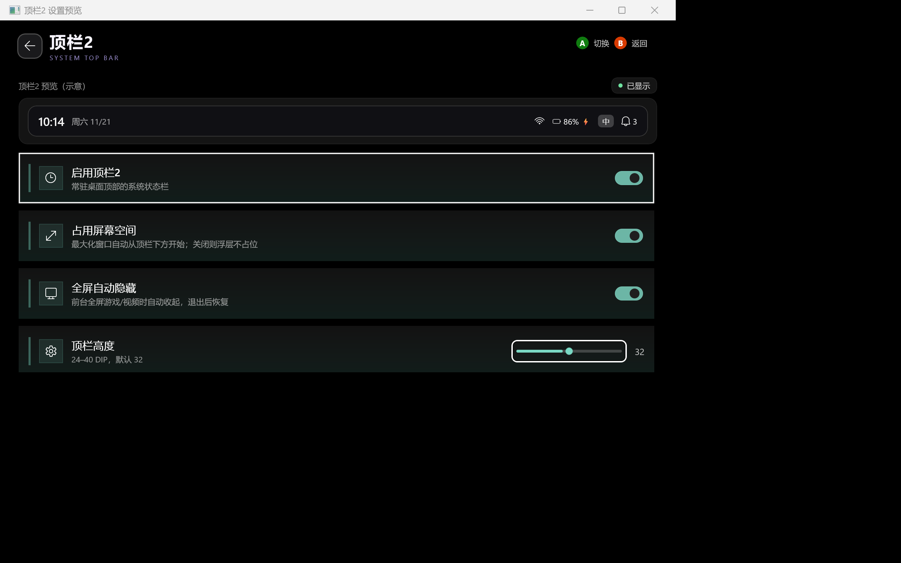
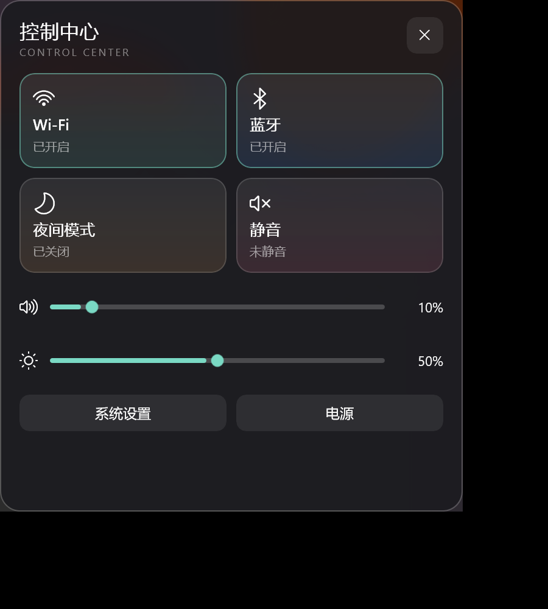
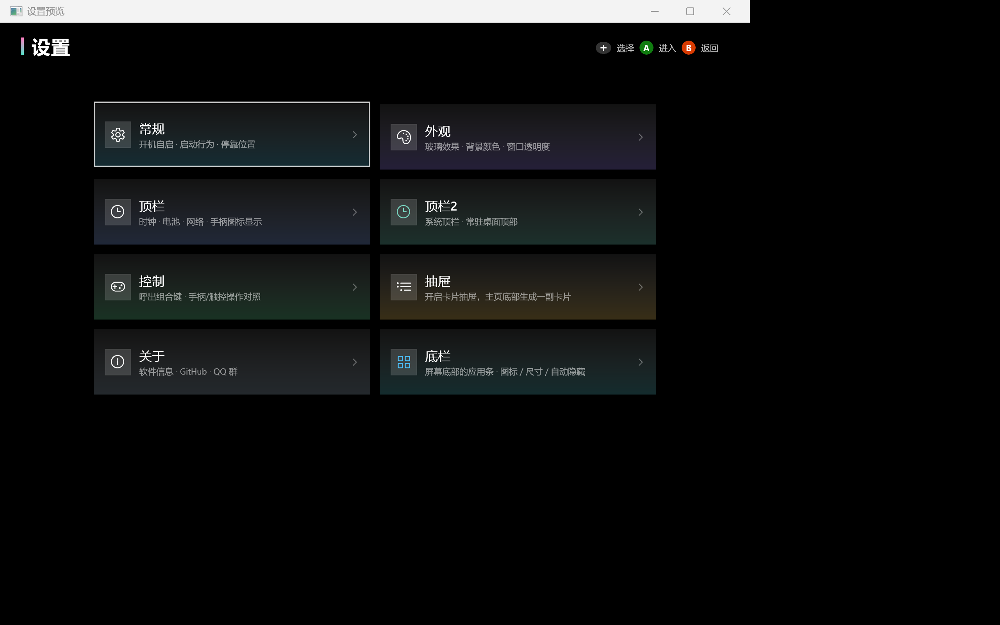

# 顶栏2（系统顶栏）开发计划

版本：v0.5（S1–S5 大部分 + 托盘）
日期：2026-11-21
状态：**顶栏窗口、基础段、控制中心、资源/电池健康、专注、计时器、托盘图标、系统日历入口已实现；待办/段排序/多屏未做**
关联文档：`docs/dock-design.md`（Dock / 系统顶栏旧设计稿）、`docs/minidock-feature-parity.md`（MiniDock 功能对照）

> 当前效果（2K / 200% 缩放实测截图，窗口直接抓取，未被其它置顶窗口遮挡）：
>
> 
>
> 参考产品：[MiniDock](https://wang01116.github.io/MiniDock/)（官网标注 MIT，仓库是否带 LICENSE 文件需再核实；只借鉴交互做法，不复制其 C 源码）。

---

## 1. 名词与边界

项目里现在有两个容易混淆的「顶栏」：

| 名称 | 指代 | 代码位置 | 本轮是否改动 |
|---|---|---|---|
| 顶栏（启动器内） | `MainPage` 内部那条信息栏，只在启动器呼出时可见 | `MainPage.xaml`、`TopbarPage.xaml(.cs)` | 不改 |
| **顶栏2（系统顶栏）** | 独立常驻桌面顶部、启动器收起后仍显示的窗口 | `StatusBarSettingsPage.xaml(.cs)`（设置页）+ 待建的 `StatusBarWindow` | 只加设置入口 |

命名约定：设置页分类叫「顶栏2」，文档与代码里也叫「系统顶栏」；两者是同一个东西。

**与底栏的关系**：底栏占屏幕底部（当前为浮层，不占位），顶栏2 占屏幕顶部。两者独立开关、独立窗口、独立生命周期，互不创建。

---

## 2. 代码现状核对（2026-11-21）

先纠正一份旧文档：`docs/dock-design.md` §14 把 `StatusBarWindow` / `StatusBarHost` / `ImeStateWatcher` / `BatteryHealthService` / `StatusBarSettingsPage` 等标成「✅ 已实现」，但**当前工作区没有这些源文件**（疑似一次文件回退丢失，`obj/` 里还留有旧的 `StatusBarWindow.xbf` / `StatusBarSettingsPage.xbf`）。本计划以代码现状为准，旧表只当设计参考。

### 2.1 可直接复用

| 能力 | 现有实现 | 状态 |
|---|---|---|
| 屏幕工作区 / 多显示器枚举 | `Services/Monitors.cs`（`All/Primary/UnderCursor`） | ✅ |
| AppBar 占位 | `Services/AppBarHost.cs`（ABM_NEW / QUERYPOS / SETPOS / REMOVE） | ✅ 基础可用，缺 ABN_POSCHANGED 回调 |
| Explorer 重启监听 | `Services/ShellRestartWatcher.cs`（TaskbarCreated） | ✅ 已写好，**尚未接到任何窗口** |
| 电量 / 充电状态 | `Services/BatteryService.cs`（`GetPercent` / `GetOnAc`） | ✅ |
| 网络 / 无线电 | `Services/NetworkService.cs`、`Services/RadioService.cs` | ✅ |
| 通知计数 / 最新通知 / 打开通知中心 | `Services/NotificationService.cs` | ✅ |
| 音量 / 亮度 / 深色模式 / 无线电面板 | `Services/SystemPanelService.cs` | ✅ 大部分可复用 |
| 电源动作 | `Services/PowerService.cs`（`PowerAction`） | ✅ 锁屏/睡眠/重启/关机 |
| 资源采样 | `PerformanceService`、`CpuCoreLoadSampler`、`GlobalMemoryStatusEx` | ✅ |
| 全屏检测 | `Services/FullscreenDetector.cs` | ✅ |
| 底栏窗口参考 | `DockWindow.xaml(.cs)`、`DockHost.cs` | ✅ 可照搬生命周期/DPI/多屏写法 |
| 设置落盘 | `Services/SettingsService.cs`（`Update` + `Current`） | ✅ |
| 预热截图模式 | `App.xaml.cs` 的 `--dock-preview` | ⚠️ 只初始化底栏，需扩展 |

### 2.2 需要新写（v0.2 更新：前四项已完成）

| 能力 | 缺什么 | 预估 |
|---|---|---|
| 顶栏窗口 | ✅ 已建 `StatusBarWindow.xaml(.cs)`：顶部横条、信息段、材质、悬停 | 完成 |
| 生命周期 | ✅ 已建 `Services/StatusBarHost.cs`：开关联动、多屏、占位、挂起 | 完成（单屏） |
| 输入法状态 | ✅ 已建 `ImeStateWatcher`：`ImmGetContext` 优先，`WM_IME_CONTROL` 回退 | 完成，待实测 |
| 通知直达窗口 | ✅ 已接 `AppWindows.ForAppId` 激活打包应用，失败回落通知中心 | 完成，待实测 |
| 电池健康 | `BatteryHealthService`：WMI 设计容量/满充容量/循环次数 | 小 |
| 计时器 / 待办 | `TimerService` / `TodoService` + 持久化 | 中 |
| 控制中心面板 | 弹层 UI、音量/亮度滑杆、卡片状态 | 大 |
| 日历入口 | 打开 Windows 通知中心/日历 | 小 |
| 顶栏设置项 | ✅ 已实现 11 行（总开关/占位/全屏/高度/材质/字号/五个段开关） | 完成 |

### 2.3 v0.2 已落地的改动（2026-11-21）

| 文件 | 改动 |
|---|---|
| `Models/AppSettings.cs` | `StatusBar*` 共 18 个设置字段：开关、占位、高度、材质、字号、段开关、顶部任务栏模式、通知已读时间 |
| `StatusBarWindow.xaml(.cs)`（新） | 全宽顶栏窗口：左侧留空，信息段靠右，最右时间两行（时间/星期+月份）；托盘/专注用图标；悬浮渐变底色（右深左透明）；悬停/按压；全屏自动隐藏 |
| `StatusBarWindow` 内的 `TransparentBackdrop` | 透明 SystemBackdrop：窗口自身不铺底色，渐变左侧能真正透出桌面 |
| `Services/StatusBarHost.cs`（新） | 单实例生命周期、AppBar 占位/撤销、DPI/Explorer 重启重排、挂起 |
| `Services/ImeStateWatcher.cs`（新） | IMM 读取前台中/EN；`ImmGetContext` 优先，`WM_IME_CONTROL` 回退 |
| `StatusBarSettingsPage.xaml(.cs)` | 18 行设置：总开关、占位、全屏隐藏、顶部任务栏模式、高度、材质、字号、基础段、专注、计时器、托盘、控制中心、资源、电池健康 |
| `StatusBarControlCenterWindow.xaml(.cs)`（新） | 控制中心弹层：Wi-Fi / 蓝牙 / 夜间 / 静音 + 音量/亮度滑杆 + 电源菜单（锁屏/睡眠/重启/关机） |
| `Services/TopTaskbarMode.cs`（新） | 顶部任务栏模式：检测任务栏在顶部 → 隐藏任务栏 → 顶栏按任务栏高度填满预留条 |
| `Services/BatteryHealthService.cs`（新） | WMI 电池健康：设计容量 / 满充容量 / 循环次数，缓存 5 分钟 |
| `Services/SystemResourceSampler.cs`（新） | CPU（GetSystemTimes 差值）/ 内存（GlobalMemoryStatusEx）采样 |
| `StatusBarWindow` 扩展 | 专注段（本程序免打扰）、计时器段（25 分钟起停，到点悬浮提示）；时间点击打开系统通知中心/日历 |
| `SettingsPage.xaml(.cs)` | 「顶栏2」分类卡片（index 3） |
| `App.xaml.cs` | 启动时初始化 `StatusBarHost`；新增 `--statusbar-preview`；`--dock-preview` 同时显示顶栏；退出兜底 |
| `MainWindow.xaml.cs` | 关闭主窗口时撤销顶栏占位 |

### 2.4 验证记录

- Release 构建：0 错误（`Build-GameLocker.cmd` 同款 `.tools/dotnet` + SDK 8 环境）。
- 运行验证（`GameLocker.exe --statusbar-preview`）：
  - 2560×1600 / 200% 缩放下窗口为 0,0,2560,64（32 DIP），信息段位置正确；
  - AppBar 占位成功，工作区由 `0,0,1280,752` 变为 `0,32,1280,752`；退出/杀进程后恢复；
  - 时间、日期、电量 100% + 充电闪电、Wi-Fi、通知铃铛均正常渲染；
  - 前台是终端时输入法段按预期隐藏（API 返回不可读）。
- 未验证：真实中/英输入态、通知计数出现、全屏游戏自动隐藏、点击跳系统设置（需要交互，留给下一轮人工验收）。
- 可选段实测：打开「资源监视」「电池健康」后显示 `CPU 5% · 72%` 与 `健康 91%`，与系统读数一致；关闭后顶栏恢复干净。
- 控制中心实测：面板打开、Wi-Fi/蓝牙/夜间/静音状态、音量 10% / 亮度 50% 读数正确；电源菜单未执行重启/关机（避免破坏当前会话）。
- 开关端到端（UIA 触发设置页 ToggleSwitch）：
  - 关 → 开：状态变“已显示”，进程主窗口变为 `GameLocker Status Bar`，工作区 `0,0,2560,1504` → `0,64,2560,1504`（顶部占 64px）；
  - 开 → 关：状态回“未启用”，工作区恢复 `0,0,2560,1504`。

设置页实测：

控制中心实测（音量/亮度读数与系统一致）：

打开「资源监视」「电池健康」两个可选段后的顶栏：

打开「专注模式」「计时器」后的顶栏：

日历入口：

点击顶栏时间打开 Windows 自己的通知中心/日历（`ms-actioncenter:`），不再自绘日历弹层。

顶部任务栏模式（系统任务栏已置顶并隐藏，顶栏2 填满 48 DIP 预留条，Win+B 托盘在顶栏下方打开）：

左侧留空、信息全部靠右，时间在 48 DIP 高度下改为两行（上时间、下星期+月份）：

悬浮渐变：左半完全透明，中间开始向右逐渐加深，最右保持可读的高透明底色（白底上验证）：

最终右侧顺序：CPU → 托盘 → 电量 → 输入法 → Wi-Fi → 专注 → 通知 → 控制中心 → 时间：

> 顶部任务栏模式的前提：系统设置里任务栏位置必须是「顶部」。系统会永久预留顶部约 48 DIP 的工作区；本模式只隐藏任务栏窗口，不回收这条预留区，顶栏2 直接用它。
> 已知限制：通知横幅（toast）仍可能留在右下角；进程被强杀时任务栏可能保持隐藏（正常关闭会恢复）；任务栏改回底部/侧边时模式会自动退出并恢复显示。

> 顶栏「托盘」只保留一个图标（chevron），点击调用 `TrayAppService.OpenSystemTray()`（SendInput Win+B + Enter）打开 Windows 自己的通知区域；此前“已登记托盘应用”的弹层已删除，底栏的托盘登记功能不受影响。
> 通知段点击改用 `ms-actioncenter:` 协议打开通知中心（比注入 Win+N 稳定），专注模式同样改为图标（月亮），开启时图标变青色、背景高亮。

---

## 3. 功能开发清单

优先级定义：**P0 = 没有它顶栏不算能用；P1 = 对齐 MiniDock 的完整体验；P2 = 增强/适配**。
「现状」列写的是本轮规划时的代码事实，不是愿望。

### 3.1 P0：先把一条能用的顶栏立起来

| ID | 功能 | 现状 / 复用 | 验收口径 |
|---|---|---|---|
| P0-01 | 顶栏窗口骨架：全宽横条、贴屏幕顶边、置顶、不抢焦点 | 新写 `StatusBarWindow` | 开关打开出现、关闭消失；点击信息段不把启动器/游戏切出前台 |
| P0-02 | 生命周期与设置联动 | 新写 `StatusBarHost`，照 `DockHost` 写法 | 改开关/换屏/改 DPI 即时生效；退出进程后工作区完全还原 |
| P0-03 | AppBar 占位（可关） | 复用 `AppBarHost`；补 ABN_POSCHANGED / 重注册 | 占位时最大化窗口从顶栏下方开始；关闭占位变浮层、不改变工作区 |
| P0-04 | 时间 + 日期 | 新写，`DateTime.Now` + 分钟对齐定时器 | 每分钟整分刷新；不跑秒级定时器（除非用户开秒） |
| P0-05 | 电量 + 充电闪电 | 复用 `BatteryService` | 有电池显示百分比，插电显示闪电；台式机无电池时整段隐藏 |
| P0-06 | 网络：WiFi / 有线 / 离线 | 复用 `NetworkService` / `RadioService` | 三种状态图标正确；拔网线/关 WiFi 5 秒内变化 |
| P0-07 | 悬停高亮 + 按压回弹 + 胶囊分组 | 新写 XAML/Composition | 悬停 100–150ms 淡入、离开淡出；按下缩到 0.96 再回弹，不抖动 |
| P0-08 | 底盘材质：亚克力 / 半透明 / 纯色 / 渐变 | 新写，参考底栏主题做法 | 四档可切；纯色/渐变可选底色与第二色 |
| P0-09 | 全屏自动隐藏 | 复用 `FullscreenDetector` | 游戏/视频全屏时自动隐藏，退出全屏 1 秒内恢复；可在设置关闭 |
| P0-10 | 异常兜底 | 新写 | 电量/网络/通知读不到时显示占位而不是崩溃；Explorer 重启后自动重注册；显示器插拔/DPI 变化重排 |
| P0-11 | 性能预算 | 设计约束 | 空闲 CPU < 0.2%；无段变化时 0 重绘；关闭的段不跑定时器 |
| P0-12 | 预览/调试模式 | 扩展 `--dock-preview` 或新增 `--statusbar-preview` | 不启动启动器即可截图调样式，便于先验收观感再写交互 |

### 3.2 P1：对齐 MiniDock 的顶栏体验

| ID | 功能 | 现状 / 复用 | 验收口径 |
|---|---|---|---|
| P1-01 | 输入法状态「中 / EN」 | 需新写 `ImeStateWatcher`（IMM） | 与系统输入法状态一致；只在段挂载时轮询（约 700ms） |
| P1-02 | 点击输入法切中/英 | 需新写，发送 Shift 或调用 IMM | 主流输入法可切换；失败时给出提示而不是静默 |
| P1-03 | 通知计数 | 复用 `NotificationService.CountSince` + `NotificationSeenTime` | 有新通知显示计数；点击后标记已读、计数归零 |
| P1-04 | 点击通知直达窗口 | 新写 AppId→进程→激活窗口；失败回落通知中心 | 记事本通知点击能激活记事本；找不到窗口时打开通知中心 |
| P1-05 | 控制中心弹层 | 新写面板；复用 `SystemPanelService` | 音量/静音/亮度/深色模式可用；WiFi/蓝牙入口跳系统设置 |
| P1-06 | 音量绑定当前输出设备 | 复用 `SystemPanelService` | 与系统音量一致；切输出设备后跟随 |
| P1-07 | 亮度（内屏 DDC/CI 失败时软件调光） | 复用 `SystemPanelService` | 台式机无背光时明确提示「不支持」 |
| P1-08 | 深色模式切换 | 复用 `SystemPanelService` | 写注册表 + 广播后资源管理器/开始菜单即时变化 |
| P1-09 | WiFi / 蓝牙二级列表 | 新写；`RadioService` 提供开关状态 | 左半点击开系统设置，右侧箭头展开可用网络/已配对设备 |
| P1-10 | 电源菜单 | 复用 `PowerService` | 锁定/睡眠/重启/关机；重启关机给 5 秒缓冲 |
| P1-11 | 电池健康 | 新写 `BatteryHealthService`（WMI） | 显示设计容量、满充容量、健康度、循环次数；读不到时显示「不支持」 |
| P1-12 | 专注模式 | 新写本程序内状态 | 开启后通知段变「免打扰」并隐藏计数；不改系统勿扰 |
| P1-13 | 计时器 | 新写 `TimerService` | 点击开始/暂停；到点提示；跨页面/重启保持 |
| P1-14 | 待办 | 新写 `TodoService` + 小窗 | 勾选/添加/删除；顶栏显示 `已完成/总数` |
| P1-15 | 资源监视（CPU / 内存 / 磁盘） | 复用采样能力 | 2 秒刷新；CPU 用 `GetSystemTimes` 差值；只在段开启时跑 |
| P1-16 | 温度 | 复用 `HwInfoGtTemperature` / `IntelGpuTemp` | 支持时显示；读不到显示 `--` |
| P1-17 | 日历入口 | 复用系统通知中心 | 点击时间打开 Windows 日历/通知中心，不自绘日历 |
| P1-18 | 托盘图标 | 复用 `TrayAppService.OpenSystemTray`；图标点击打开系统托盘 | 不再有自定义托盘列表 |
| P1-19 | 段开关 / 左右停靠 / 顺序 / 双倍宽 | 新写设置页 | 每段可开关；可切左/右；上移下移；双倍宽按段给最小宽度 |
| P1-20 | 点击时段动作 | 新写 | 时间→日历，通知→通知中心，电量→电池健康，网络→控制中心 |

### 3.3 P2：增强与适配

| ID | 功能 | 说明 |
|---|---|---|
| P2-01 | 多显示器逐屏顶栏 | 每块目标屏一个窗口并各自占位；先做主屏，后做镜像/指定屏 |
| P2-02 | 跟随系统深浅色 / 强调色 | 材质与文字色随系统切换，避免固定深色 |
| P2-03 | 字号 / 文字颜色 / 不透明度 | 字号 10–18，颜色预设 + 自定义，作用到全部段 |
| P2-04 | 时间格式 / 秒 / 农历 / 干支 | 自定义格式串；农历用 `ChineseLunisolarCalendar` |
| P2-05 | 天气 / 小组件扩展 | 复用 `WeatherService`；只在开启时联网刷新 |
| P2-06 | 低配/节能模式 | 一键关模糊与动画；低电量自动降级 |
| P2-07 | 配置导入导出 / 恢复默认 | 与设置页其它分类共用一套机制 |
| P2-08 | 高对比度 / 无障碍 | 键盘可遍历、屏幕阅读器可读、200% 缩放下不裁切 |
| P2-09 | 顶栏快捷键 | 显隐/控制中心/专注，允许自定义 |

---

## 4. 设置项规划（「顶栏2」页面）

本轮只有「启用顶栏2」。后续按阶段补：

### 4.1 基础
- 启用顶栏2（已加）
- 占用屏幕空间（AppBar 占位）——默认建议**开**，可切浮层
- 顶栏高度（24–40，默认 32）
- 全屏时自动隐藏（默认开）

### 4.2 外观
- 底盘材质：跟随系统（亚克力）/ 半透明 / 纯色 / 渐变
- 底色、渐变第二色、不透明度
- 字号（10–18）、文字颜色（预设 4 色 + 自定义）
- 时间格式、显示秒、显示农历/干支

### 4.3 信息段
- 左侧 / 右侧归属
- 上移 / 下移
- 双倍宽
- 每段开关：时间日期 / 电量 / 网络 / 输入法 / 通知 / 资源 / 专注 / 计时器 / 待办 / 电池健康 / 电源
- 通知已读策略（点击即已读 / 仅计数）

### 4.4 行为
- 点击时段动作（日历 / 通知中心 / 控制中心 / 电池健康）
- 多显示器：仅主屏 / 跟随鼠标 / 指定屏 / 逐屏镜像
- 控制中心卡片排序（P1 后）

---

## 5. 技术方案要点

### 5.1 窗口与占位
- 同进程新增 WinUI 顶层 `Window`，复用 GameLocker 的 `SettingsService`，不引入 IPC。
- 贴顶边、全宽、高度 = `round(32 × DPI scale)`；`SetWindowPos(HWND_TOPMOST)` 保持置顶。
- 占位走 `AppBarHost.Register(hwnd, EdgeTop, height, monitor)`；浮层模式改用 `EdgeRect`，不注册。
- **补 AppBar 缺口**：现 `AppBarHost` 注册后没有消息回调，任务栏位置变化/分辨率变化时不会重排；需要：
  - 窗口 WndProc 处理 `ABN_POSCHANGED` / `WM_SETTINGCHANGE`；
  - 订阅 `ShellRestartWatcher.TaskbarRecreated`，切回 UI 线程重注册；
  - `ABM_REMOVE` 必须在窗口关闭/进程退出时调用，否则工作区会留白。

### 5.2 焦点与输入
- 顶栏点击不应激活窗口：HWND 创建后追加 `WS_EX_NOACTIVATE` 与 `WS_EX_TOOLWINDOW`。
- 悬停/按压用 XAML 指针事件即可，不引入全局鼠标钩子；控制中心/日历弹层需要焦点时再显式激活。
- 全屏游戏场景：`FullscreenDetector` 检测到前台全屏 → 隐藏顶栏并暂停计时器；退出后恢复。

### 5.3 数据刷新
- 单条「调度器」管理各段定时器：段未挂载不创建；关闭/全屏/挂起时全部停。
- 时间：分钟对齐（开秒才 1s）；输入法 ~700ms；资源 2s；电量/网络 5s；通知 10s。
- 每段独立失效，只重绘变化的段；禁止整条顶栏定时重绘。
- 数据源异常一律回落占位符，并写一次 `DebugLog`，不弹窗。

### 5.4 多显示器与 DPI
- P0 只做主屏；`Monitors` 已有多屏枚举，P2 再扩。
- `XamlRoot.Changed` + 缩放变化判定重排；避免自身 `MoveTo` 触发回环。
- 每块屏独立占位（AppBar 是「每显示器」概念），不能只注册一次。

### 5.5 与其它模块的联动
- `AppSettings.StatusBarEnabled` 控制 `StatusBarHost.ApplyAsync()`；设置页改开关立即调用。
- 下载模式/全屏遮罩：新增 `Suspend(bool)`，与 `DockHost.Suspend` 同节奏。
- 启动器退出/进程退出：`StatusBarHost.Shutdown()` 释放占位与窗口。
- 预览模式：`--dock-preview` 里同时初始化顶栏，便于截图验收。

---

## 6. 分阶段计划

| 阶段 | 内容 | 产出 | 验收 |
|---|---|---|---|
| **S0（已完成）** | 设置入口 + 开关偏好 + 本计划 | `StatusBarSettingsPage`、`StatusBarEnabled`、本文档 | 设置页可进、开关可落盘、不创建窗口 |
| **S1（已完成）** | 窗口骨架 + 生命周期 + AppBar + 时间/日期 + 预览模式 | `StatusBarWindow`、`StatusBarHost` | 开关即显隐；占位/浮层可切；最大化避让 |
| **S2（已完成）** | 电量/网络 + 悬停/按压 + 材质 + 全屏自动隐藏 | 信息段与外观 | 日常信息正确；观感过用户验收 |
| **S3（基本完成）** | 输入法 + 通知计数/直达 + 段开关 + 设置页完整化 | 交互闭环 | 中/EN 正确；通知点击可达（待实测） |
| **S4（完成）** | 控制中心 + 音量/亮度/夜间/静音 + WiFi/蓝牙 + 电源菜单 | 轻控制能力 | 常用开关不用离开顶栏 |
| S5 | 专注 / 计时器 / 待办 / 电池健康 / 资源监视 | 信息增强 | 数据准确、可持久化 |
| S6 | 多显示器 + 深浅色/字号 + 性能与稳定性验收 | 发布候选 | 见 §7 |

原则：**每个阶段先出静态样张再写交互**；S1/S2 不通过观感验收就不往下堆功能。

---

## 7. 验收标准

### 7.1 功能
- 默认关闭；打开后顶部出现顶栏，关闭后窗口销毁、工作区还原。
- 时间/日期、电量、网络、输入法、通知五段在正常机器上均正确。
- 点击各段行为符合 §3.2；控制中心主要开关可用。
- 设置项改完即时生效，重启后保持。

### 7.2 稳定性
- 无电池、无 WiFi、无输入法、通知注册表缺失时不崩溃。
- Explorer 重启、分辨率/DPI 变化、显示器插拔后自动恢复。
- 全屏游戏自动隐藏；退出游戏恢复，不抢焦点、不挡输入。

### 7.3 性能
- 空闲 CPU < 0.2%，无段变化时 0 重绘。
- 默认无秒级定时器；各段定时器可停。
- 常驻内存增量控制在 20 MB 内（WinUI 窗口基础开销）。
- 顶栏自身重绘 ≤ 1 次/分钟（时间分钟刷新）。

### 7.4 视觉
- 与 MiniDock 参考样张对比：圆角、胶囊、字号层级、材质过渡、悬停回弹一致或更好。
- 125% / 150% / 200% 缩放下不裁切、不模糊。

---

## 8. 风险与对策

| 风险 | 影响 | 对策 |
|---|---|---|
| AppBar 与系统任务栏/底栏抢工作区 | 桌面可用区异常 | 顶栏只占顶部、底栏保持浮层；设置页显示实时占位总和；退出必 `ABM_REMOVE` |
| `WS_EX_NOACTIVATE` 下弹层拿不到焦点 | 控制中心点不动 | 弹层单独建可激活窗口，或临时清标志后恢复 |
| WinUI 顶层窗口 Z 序被全屏程序压制 | 顶栏被盖住 | 全屏时主动隐藏；窗口 `TOPMOST` + 定时校验 |
| 输入法状态读取不稳 | 中/EN 显示错误 | 只在段挂载时读；失败显示 `--`；点击切换失败给提示 |
| 通知 AppId → 窗口映射失败 | 点击无反应 | 回落打开通知中心，并记录日志 |
| 观感再次不达预期 | 返工 | S0 先样张、S2 先静态后交互；每阶段让用户验收 |
| 范围膨胀 | 又变成半成品 | 严格按 P0→P1→P2；控制中心/多屏不提前 |
| 与旧文档冲突 | 误判进度 | 以本文件 §2 的代码核对为准；旧 §14 只作参考 |

---

## 9. 待确认问题

1. ~~**默认开关**~~：已按“默认关”实现；稳定后再决定是否默认开。
2. ~~**占位方式**~~：已按“默认 AppBar 占位、可在设置关闭”实现。
3. **控制中心**：P1 是否必做？还是顶栏只做信息显示 + 少量跳转？（目前未做）
4. **高度/字号默认值**：32 DIP / 12 已实现，是否合适？
5. ~~**全屏自动隐藏**~~：已实现，默认开、可在设置关闭；待真实全屏游戏验收。
6. **多显示器**：首版只主屏可以接受吗？（目前只主屏）
7. ~~**输入法点击切换**~~：已按“尽力发 Shift、失败不报错”实现；显示准确性待验收。

---

## 10. 附：与旧设计稿的差异

- 旧稿把「系统顶栏」直接叫「系统顶栏」，设置页分类叫「顶栏 2」；本轮统一为设置页「顶栏2」。
- 旧稿计划默认占位、默认开启；本轮实现为**默认关闭、默认占位**，等观感验收后再决定是否默认开。
- 旧稿 §14 的「已实现」清单与当前代码不符，已在本文件 §2 重新核对。
- 旧稿的「顶栏只显示、不控制」在 P0 仍成立；P1 的控制中心是新增范围，需用户确认（见 §9-3）。

---

## 11. 实现进度（2026-11-21）

| 功能 | 状态 | 代码位置 |
|---|---|---|
| 顶栏窗口骨架 / 贴顶 / 置顶 / 不抢焦点 | ✅ 已实测 | `StatusBarWindow.xaml(.cs)` |
| 生命周期、开关联动、退出撤销 | ✅ 已实测 | `StatusBarHost.cs`、`App.xaml.cs`、`MainWindow.xaml.cs` |
| AppBar 占位（可关） | ✅ 已实测工作区 0→32 | `StatusBarHost.ReRegister` + `AppBarHost` |
| 时间 + 日期（分钟对齐） | ✅ | `StatusBarWindow.ScheduleClock` |
| 电量 + 充电闪电 | ✅ 实测 100% + 闪电 | `BatteryService` |
| 网络 Wi-Fi / 有线 / 离线 | ✅ 实测 Wi-Fi | `NetworkService` + `NetworkInterface` |
| 输入法中/EN | ⚠️ 代码完成，未在真实中文输入态下验收 | `ImeStateWatcher.cs` |
| 通知计数 + 点击（打包应用直达 / 其它开通知中心） | ⚠️ 计数逻辑就绪，未造新通知验收 | `StatusBarWindow.OnNotificationTapped` |
| 悬停高亮 / 按压回弹 | ✅ 代码完成 | `OnSegmentPointer*` |
| 四档底盘材质（亚克力/半透明/纯色/渐变） | ✅ 设置页可切 | `StatusBarWindow.ApplyBackdrop` |
| 高度 / 字号 / 段开关 | ✅ 设置页可调即时生效 | `StatusBarSettingsPage` |
| 全屏自动隐藏 | ✅ 代码完成，未用真实全屏游戏验收 | `FullscreenDetector` + `StatusBarHost.OnFullscreenChanged` |
| Explorer 重启重注册 | ✅ 代码接好（未实测重启 Explorer） | `ShellRestartWatcher` |
| 预览模式 | ✅ `--statusbar-preview` / `--dock-preview` | `App.xaml.cs` |
| 控制中心（Wi-Fi/蓝牙/夜间/静音 + 音量/亮度） | ✅ 基础版已实测面板与读数 | `StatusBarControlCenterWindow` |
| 控制中心电源菜单（锁屏/睡眠/重启/关机） | ✅ 已接 `PowerService`；重启/关机有二次确认 | `StatusBarControlCenterWindow` |
| 专注 / 计时器 / 待办 | ✅ 专注 + 计时器；待办未做 | `StatusBarWindow` |
| 资源监视（CPU/内存） | ✅ 可选段，2 秒刷新，点击任务管理器 | `SystemResourceSampler` + `StatusBarWindow` |
| 电池健康（设计/满充/循环） | ✅ 可选段，WMI 读取，实测 91% | `BatteryHealthService` |
| 日历入口 | ✅ 点击时间打开系统通知中心/日历；自绘日历已删除 | `StatusBarWindow` + `NotificationService` |
| 托盘图标 | ✅ 图标（chevron），点击打开/再点关闭系统托盘；箭头随面板开合翻转；位置与 Wi-Fi 对调 | `StatusBarWindow` + `TrayAppService` |
| 通知图标 | ✅ 点击打开通知中心（ms-actioncenter），再点关闭（Esc）；Wi-Fi 移到原托盘位置 | `StatusBarWindow` + `NotificationService` |
| 顶部任务栏模式 | ✅ 实测：任务栏置顶后隐藏，顶栏按 48 DIP 填满预留条；Win+B 托盘、Win+N 通知中心仍在顶部 | `TopTaskbarMode` + `StatusBarHost` |
| 信息右置 / 两行时间 | ✅ 左侧留空，所有信息靠右；48 DIP 时上时间、下星期+月份，32 DIP 自动回落单行 | `StatusBarWindow` |
| 悬浮 + 高透明渐变 | ✅ 窗口透明、Bar 悬浮留边、圆角；左半透明，中段开始向右渐深 | `TransparentBackdrop` + `ApplyFloatingBar` |
| 段排序 / 左右停靠 / 双倍宽 | ⏳ 未做 | — |
| 多显示器 / 主题跟随 | ⏳ 未做 | — |

### 11.1 已知问题 / 下一步

1. **输入法段经常隐藏**：当前机器前台常是无 IME 的窗口，`ImeStateWatcher` 返回 null；需要在记事本/浏览器里切中文再验证一次。若长期读不到，考虑退化为显示 `--` 而不是隐藏。
2. **通知计数没有造样本**：用一个会发通知的应用触发后再点铃铛，验证“直达 / 回落通知中心 / 已读归零”。
3. **全屏隐藏未实测**：需要一场无边框全屏游戏或视频，确认 AppBar 被撤销、退出后恢复。
4. **Z 序**：实测时另一置顶监控条会盖住顶栏右侧；同进程正式运行时若仍被盖，考虑每秒轻量重提 `HWND_TOPMOST`。
5. **默认值**：目前默认关闭 + 占位开；等 §7 验收后再决定是否默认开。

---

## 12. 开关在哪里

**设置 → 「顶栏2」卡片 → 第一行「启用顶栏2」**。卡片在「顶栏」右侧；窄侧边栏（单列）时是第 4 张，向下滚一点即可看到。

> 2026-11-21 已把新构建部署到 `.setup\current-build` 并重启。若仍只看到「顶栏」没有「顶栏2」，说明启动的仍是旧 exe，请用 `Start-GameLocker.cmd` 或确认进程路径。

